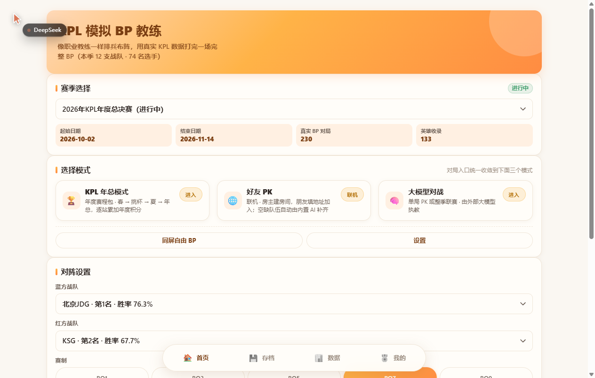
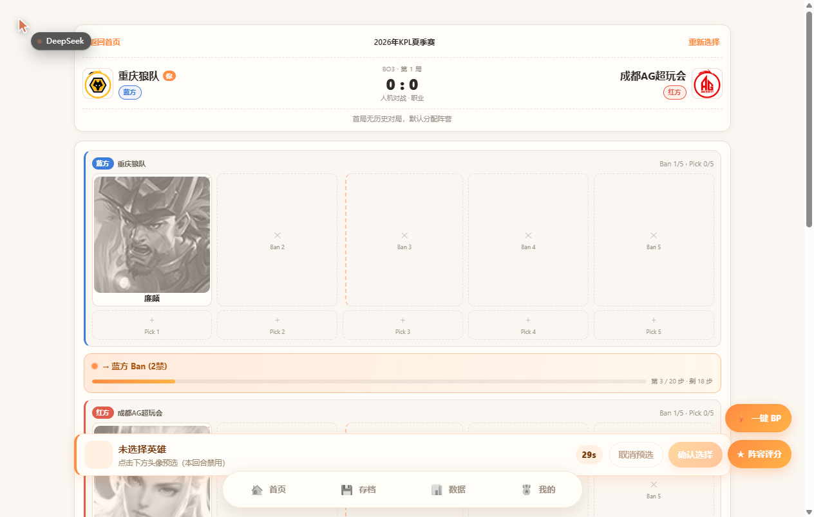
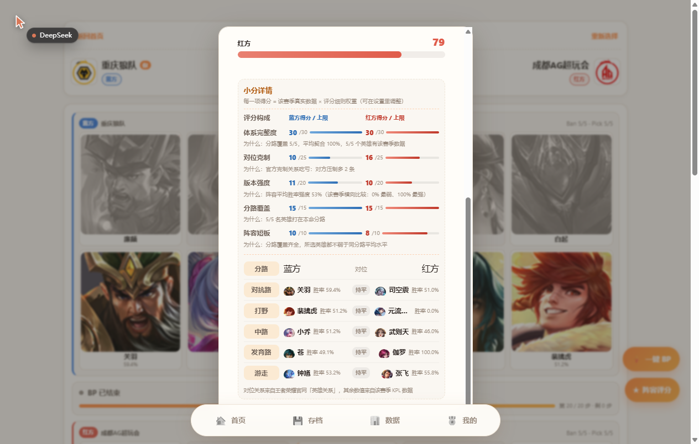
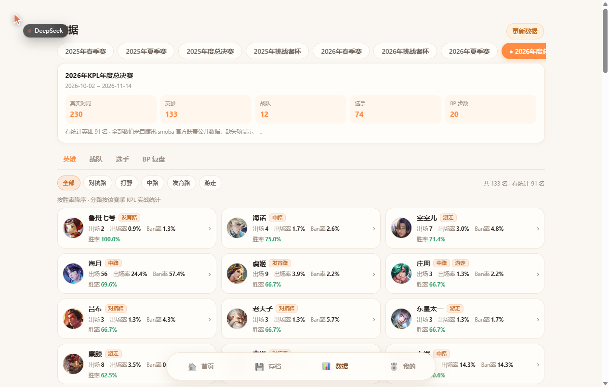
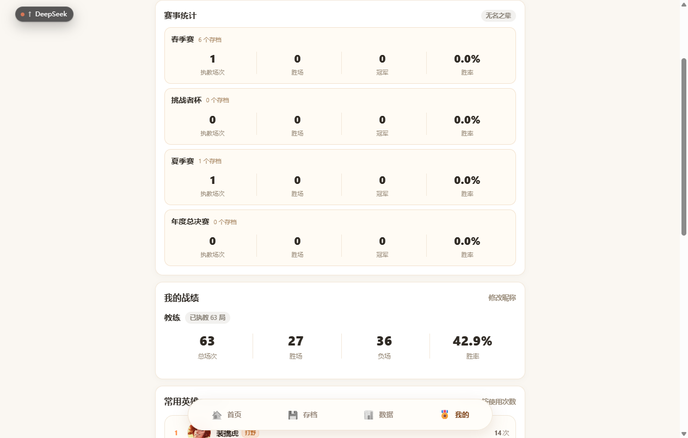

# KPL 模拟 BP 教练

> 一个粉丝自制的 **KPL 模拟 BP 教练小游戏**：像职业教练一样排兵布阵，用**真实 KPL 数据**打完一场完整 BP。
> 纯本地运行，双击启动，浏览器即玩 —— 不需要注册、不需要联网登录。



---

## 这是什么

你是教练，对面是 AI（或你的朋友）。双方按 KPL 官方规则轮流 Ban / Pick，
打完一局后系统会用**该赛季真实数据**给你的阵容打分，并告诉你每一分是怎么来的。

- **BP 规则**：20 步（每方 5 ban + 5 pick）、全局 BP（按队伍独立计）、巅峰对决盲选
- **数据**：8 个 KPL 赛季的真实英雄胜率 / 出场率 / Ban 率、战队战绩、选手数据、历史 BP 对局
- **AI**：三档难度，决策全部基于所选赛季的真实数据
- **模式**：AI 对战 / 同屏自由 BP / 好友联机 PK / 大模型对战 / KPL 年总模式（完整赛季）

---

## 截图

| BP 面板 | 结算与小分详情 |
| --- | --- |
|  |  |

| 数据中心 | 我的（四类赛事统计） |
| --- | --- |
|  |  |

---

## 功能特性

### BP 与 AI
- **完整 20 步 BP**：每方 5 个 Ban 位 + 5 个 Pick 位，顺序与 KPL 现行规则一致
- **全局 BP 按队伍独立**：一个 BO 里自己用过的英雄自己不能再选，**禁人池 = 对方的可选池**
- **巅峰对决**：BO7 打到 3:3 / BO9 打到 4:4 触发盲选，双方同时各选 5 人、可撞英雄，
  选完按「对抗路 → 打野 → 中路 → 发育路 → 游走」**逐路 1 秒展示**，再进入结算
- **三档 AI**：入门（带随机）/ 职业（纯公式）/ 魔王（额外针对你的绝活英雄）
- **一键 BP**：懒得点？一键把双方剩余手全部交给 AI

### 赛后评分
- **0–100 分**，五项构成：体系完整度 / 对位克制 / 版本强度 / 分路覆盖 / 阵容短板
- 结算页给出**双方小分详情**：每一项得分、上限、以及「为什么」是这个分数
- 再往下是**五路对位对比**（双方英雄 + 该赛季胜率 + 官方克制关系）
- **评分细则可在「设置」里改**：五项权重、分路命中系数、短板阈值都能调，改完立即生效

### 赛事与生涯
- **单届赛事**：春季赛 / 夏季赛（18 队 SAB 三阶段 + 卡位赛 + 双败季后赛）、挑战者杯（32 队）、年度总决赛（12 队 擂台赛 + 突围赛 + 双败淘汰）
- **KPL 年总模式**：春 → 挑战者杯 → 夏 → 年总，四站串联、逐站累加年度积分
- **存档系统**：本地 JSON 存档，随时读档继续；支持重命名 / 删除 / 分类筛选
- **对阵图**：季后赛、挑杯、年总淘汰赛都有实时流程图
- **历史回看**：打完的赛季可以回看每一轮的对阵图与比分

### 联机与扩展
- **好友联机 PK**：房主开房，朋友填地址加入；支持单局 BO1/3/5/7/9 与整赛季联赛
  - 真人上限 = 该赛事参赛队数（联赛 18 / 挑杯 32 / 年总 12），**空位自动由内置 AI 补齐**，1 个人也能开赛
  - 队名自拟（不能用 KPL 战队名，避免队伍胜率影响好友对局）
  - 掉线重进按**昵称**自动坐回原队伍
- **大模型对战**：接入任意 OpenAI 兼容接口（DeepSeek 等），让大模型当你的对手；
  接口异常会自动回退内置 AI，不会中断对局
- **数据中心**：8 个赛季的英雄 / 战队 / 选手数据切换查看，英雄详情含官方分路与克制关系

---

## 快速开始

### Windows

双击 **`start.bat`**（需要先装好 Python 3.8+，勾选「Add Python to PATH」）。

### macOS / Linux

```bash
chmod +x start.sh
./start.sh
```

启动脚本会自动：检查 Python → 建虚拟环境 `.venv` → 装依赖 → 启动服务 → 打开浏览器。

默认地址：<http://127.0.0.1:5000>

> **数据已经打包在 `data/` 里**，第一次启动不需要抓数据、也不会联网。
> 想更新到最新赛季，进游戏后打开「数据 → 更新数据」，点「更新并抓取」即可（也可点「更新官网英雄数据」单独刷新英雄分路与克制关系）。

### 手动启动

```bash
pip install -r requirements.txt
python app.py
```

---


## 项目结构

```
kpl_bp_game/
├── app.py                 # Flask 主入口（页面路由 + REST API）
├── launcher.py            # 启动器（找 Python / 开浏览器 / 端口探测）
├── scraper.py             # 真实数据采集脚本（独立可跑，带 --verify）
├── requirements.txt
├── start.bat / start.sh   # 一键启动
├── game/                  # 核心引擎（纯标准库，与 Web 层解耦）
│   ├── bp_engine.py       # BP 规则引擎（20 步 / 全局 BP / 巅峰对决）
│   ├── ai_coach.py        # AI 教练（三档难度）
│   ├── scorer.py          # 阵容评分（五项 + 小分详情）
│   ├── tournament.py      # 赛制引擎（联赛 SAB / 挑战者杯 / 年总 / 年总赛程包）
│   ├── data_loader.py     # 赛季数据上下文
│   ├── kpl_rules.py       # 赛制规则（读 data/kpl_rules.json）
│   ├── scoring_rules.py   # 评分细则（可在线修改）
│   ├── room_engine.py     # 好友联机房间
│   ├── llm_coach.py       # 大模型对手
│   └── ...
├── data/                  # 真实数据（已随仓库提供）
│   ├── heroes.json            # 全英雄总表（含官方分路）
│   ├── leagues.json           # 8 个赛事索引
│   ├── team_meta.json         # 战队信息
│   ├── hero_relations.json    # 官方克制关系
│   ├── kpl_rules.json         # 赛制规则
│   ├── scoring_rules.json     # 评分细则（可改）
│   ├── hero_stats_by_league/  # 每赛季英雄数据
│   ├── player_stats_by_league/
│   ├── team_stats_by_league/
│   └── bp_history_by_league/  # 每赛季历史 BP 对局
├── static/                # 原生 CSS / JS / 英雄头像 / 战队 logo
├── templates/             # Jinja2 页面
└── docs/                  # 接口契约与测试指南
```

**技术栈**：Python 3.8+ / Flask + 原生 HTML/CSS/JavaScript。
没有任何前端构建步骤（不用 npm / Webpack / React / Vue），改完刷新即生效。

---

## 评分细则（可自定义）

默认权重（总和 100）：

| 分项 | 默认 | 说明 |
| --- | --- | --- |
| 体系完整度 | 30 | 前排 / 输出 / 开团 / 续航是否齐全 |
| 对位克制 | 25 | 官方「压制 / 被压制」关系算净优势 |
| 版本强度 | 20 | 该赛季 KPL 真实胜率的横向映射 |
| 分路覆盖 | 15 | 5 个 pick 与真实分路的契合度 |
| 阵容短板 | 10 | 分路缺口与胜率明显偏低 |

进「设置 → 评分细则」可以改五项权重与几个系数（主/副分路命中系数、副分路折算、短板阈值），
保存后立即生效，也能一键恢复默认。某项无数据时其权重会按比例转移给其它项，不会算错。

---

## 免责声明

> **本产品为粉丝自制模拟工具，与腾讯、KPL、王者荣耀官方无关，数据仅供娱乐。**

- 游戏内所有英雄头像、英雄名称、战队名称、赛事数据，版权归**腾讯公司 / 王者荣耀 / KPL 赛事方**所有；
- 本项目仅用于**学习与娱乐**，不提供任何商业化服务，不收集任何个人信息；
- 数据来自官方公开页面，如涉及版权问题请联系删除。

## License

本项目**代码**以 [MIT License](LICENSE) 开源；
`data/` 下的赛事数据与 `static/images/` 下的图片资源**版权归原权利人所有**，不在 MIT 授权范围内，
请勿用于商业用途。

---

## 常见问题

**Q：双击 `start.bat` 一闪就没了？**
A：多半是没装 Python 或没勾选「Add Python to PATH」。装好 Python 3.8+ 后重试；
也可以在命令行里运行 `python app.py` 看具体报错。

**Q：端口 5000 被占用？**
A：程序会自动顺延到 5001、5002… 并打开正确地址；也可以进「设置 → 服务器访问地址」改成别的端口。

**Q：想和朋友联机，但不在同一个局域网？**
A：房主开房后，用内网穿透工具（frp / ngrok 等）把端口映射出去，把映射后的地址发给朋友即可。
同一个 Wi-Fi 下直接填房主的内网 IP + 端口。
。

**Q：能改评分标准吗？**
A：可以，「设置 → 评分细则」，五项权重和系数都能调，页面里写了每个参数的含义与默认值。

---


